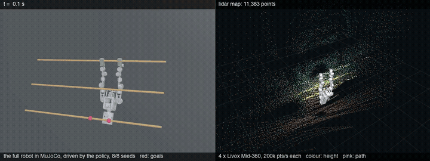
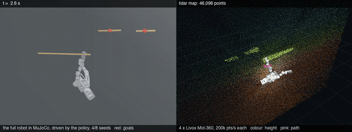
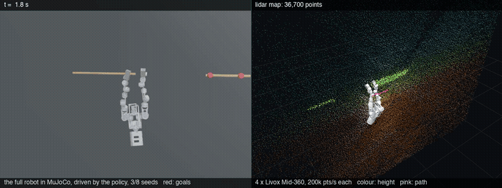

# Bimanual wall-climbing robot

A 24.5 kg robot with two seven-joint arms and hooked hands that hangs from rungs on walls,
in MuJoCo, and one PPO policy that learns seven climbing skills with it: traverse a rung,
cross gaps, climb rows up and down, descend a staircase, step up to a higher tier and move
round a corner onto a perpendicular wall.

| | |
|---|---|
| [`cad/`](cad/README.md) | the mechanical design: vendor actuator and lidar CAD, the brackets between them, the pelvis and chest bay, and the tools that check them. The robot is generated from here |
| [`urdf/`](urdf/README.md) | the generated robot, the scene, 86 sensors, the four lidars, and the measured properties of all of it |
| [`rl/`](rl/README.md) | the task, its reward and sensor models, the benchmark lessons, generated walls with ADR, reference climbs, and PPO on MJX (GPU) |
| [`slam/`](slam/README.md) | the SLAM test rig: simulated Mid-360 point clouds through FAST-LIO2 in Docker |
| [`demo/`](demo/README.md) | demo videos from an earlier policy (see below) |

```bash
python -m venv .venv && . .venv/bin/activate     # Windows: .venv\Scripts\activate
pip install -r requirements.txt

python -m rl.lessons                 # generate the lesson scenes (not in git)
python -m rl.climb_task              # the RL task, plus every reward and sensor invariant

# on a rented Linux + NVIDIA box, from a clone of the tag paper-v1
bash rl/gpu_setup.sh
mkdir -p out && nohup bash rl/paper_run.sh p_s0 > out/p_s0.console 2>&1 &
DRY=1 bash rl/paper_run.sh a_rfcl_s1          # what a run name means, without running it

# back home, on CPUs
python -m rl.paper_eval --jobs 8     # every evaluation of the paper, over the runs in out/
```

## The method

One goal-conditioned policy is trained with PPO on MJX. Training combines:

- **procedural walls**, one family per lesson, whose difficulty grows by automatic domain
  randomization (ADR) under a prerequisite graph;
- **reference climbs used only as episode starts**, drawn toward the frontier of what the
  policy can finish. There are 19 of them for families 3 to 7, found by search (CEM) or
  recorded from a policy driven by hand, giving 1481 starts and 7372 states;
- **behaviour cloning restricted to that frontier**, added to PPO's gradient;
- **a reward whose shaping term is a two-way potential** over a route graph through the
  rungs, with holds decided by contact force, not by distance;
- **dynamics randomization** of masses, friction, torque limits and setpoint lag.

## The benchmark

Seven lessons, one skill each, every one starting from a two-hook hang and scored on the
full robot in C MuJoCo, toward the left and mirrored ([`rl/README.md`](rl/README.md)):

| | | | |
|---|---|---|---|
| 1 traverse along a rung | 2 traverse a broken rung | 3 climb up rows standing out | 4 climb down rows standing in |
| 5 down a staircase | 6 diagonally up a tier | 7 round a corner | |

The benchmark walls are never drawn in training. Generalization is measured on 200 unseen
walls per family, drawn as training draws them from seeds no run uses, and on walls one
step past the last level of training.

## The paper's runs

Every run starts from the tag `paper-v1` and is launched by its name alone
(`rl/paper_run.sh`): the name sets the families, steps, seed, ablation and reward weights,
and a run refuses to resume on other code than it started on.

| runs | names | steps |
|---|---|---|
| the method, 5 seeds | `p_s0` .. `p_s4` | 1.5B |
| the method under the ablations' budget | `a_none_s0..2` | 0.75B |
| ablations, 3 seeds each | `a_<x>_s0..2`, x = rsi, frontier, rfcl, clone, cloneall, curriculum, taught, route, hold | 0.75B |
| PPO alone | `a_plain_s0..2` | 0.75B |
| one specialist per family | `b<f>_s0..2`, f = 1..7 | 0.75B |
| reward-weight sensitivity | `w_bank05_s0`, `w_bank2_s0`, `w_reach05_s0`, `w_reach2_s0`, `w_slide05_s0`, `w_slide2_s0` | 0.75B |
| reward exploits, families 1-3 | `x_none`, `x_oneway`, `x_world`, `x_grab`, `x_refund`, `x_route`, `x_hold` | 100M |

Status: the pipeline is checked end to end on the current robot (preflight, every run
configuration started, saved and resumed, the evaluation read back). The runs themselves
are next.

## Demo

These videos are from an **earlier version**: the policy gpu14 (2.2B steps), trained on
the previous body and a nine-lesson curriculum. Lessons 8 (onto the wall behind) and 9
(swing across a gap) are no longer in the benchmark; the code keeps them for later work.
Left: the full robot in MuJoCo. Right: the map its four Livox Mid-360 lidars build as it
climbs, simulated point by point along the sensor's own scan pattern. More, and how they
were made, in [`demo/`](demo/README.md).

| climb down rows standing in (lesson 4) | step up a tier (lesson 6) |
|---|---|
| [](demo/lesson04_climb_down.mp4) | [](demo/lesson06_step_up.mp4) |

| swing across a 0.90 m gap (lesson 9, earlier curriculum) |
|---|
| [](demo/lesson09_swing_gap.mp4) |

## Real parts, not blocks

Every joint is a purchasable CubeMars AK-series actuator, every mass and inertia comes
from the CAD solids, and every torque limit off a datasheet. Nothing in `urdf/` is a
plausible-looking number, and nothing there is hand-written: `cad/tools/gen_urdf.py`
and `urdf/_gen_scene.py` write it.

The robot weighs **21.86 kg**, including a 48 V battery, an NVIDIA Jetson Orin NX, the
IMU and the power electronics in the chest, and **24.50 kg** with the four Livox Mid-360
lidars and the tube cage that guards them. The 17 actuators are 52 % of that
([`urdf/README.md`](urdf/README.md)). Its proportions are those of a 1.40 m person: upper
arm 0.26 m, forearm 0.21 m, the waist yaw 0.305 m below the shoulders at navel height, and
the pelvis drilled for two hip pitch actuators where legs would attach. The shoulder is
pitch-first, like ten of the twelve humanoids it was checked against. Its vertical reach
with one hook anchored is 0.56 m.

The robot this replaced (aluminium cylinders with masses derived from geometry, 11.13 kg,
fine in simulation and impossible to build) is in git history.

## What the policy sees

Encoders, IMU, wrist force/torque sensors and grip pads, with noise and per-episode
offsets. The wall map holds only what the four Mid-360 have seen past the robot's own arms
and cage. The lidar odometry drifts, arrives late, and is believed along a rung only where
a second wall makes that direction observable: measured with FAST-LIO2 on simulated
Mid-360s, a flat wall does not tell a lidar where it is along the wall
([`slam/README.md`](slam/README.md)).

The RL side's other output is a list of things the task rewarded that were not climbing:
the hook sliding along a smooth rung, a one-way reward that can be pumped, a sum over two
hands that does not care which hand works. Each is now an assertion in
`python -m rl.climb_task`, and six of them are trained again on purpose (the `x_` runs) to
show what each rule prevents.

## Platforms

Training runs on an NVIDIA GPU: the physics, the task and the policy on the card
(`rl/mjx_task.py`, checked against the C MuJoCo task by `rl.mjx_check`);
`requirements-gpu.txt` pins that stack. Everything else (the checks, the evaluation, the
figures) runs on macOS, Linux and Windows, MJX itself too, slowly, on a CPU.

`ffmpeg` is needed only by `rl.render`, never for training. Docker is needed only by
the SLAM rig.

## Two rules that shaped everything here

**The policy reads only what real hardware has**: encoders, IMU, force/torque, grip
pads, and a wall map from its own lidars. Ground truth (`data.xpos`, `env.latched`)
appears in tests and in the RL reward, which is a training-time oracle, and nowhere
else.

**Measure, then decide.** Nearly every design choice in the subsystem READMEs is
followed by the number that forced it, and several of them overturned an idea that
looked obviously right first, including a pinned-base reach calculation that was
wrong by 2x, and a "fix" for hand crossing that quietly made the hands overlap
instead.

## License

Copyright (c) 2026 Thuong Nguyen Van. All rights reserved: public to read, run and
review, not to reuse or publish from without permission ([`LICENSE`](LICENSE)). To cite
it, see [`CITATION.cff`](CITATION.cff).
