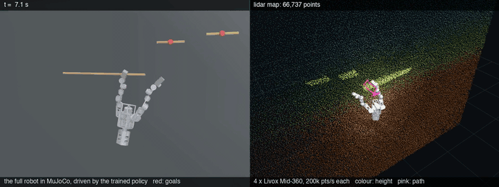
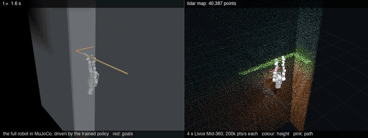
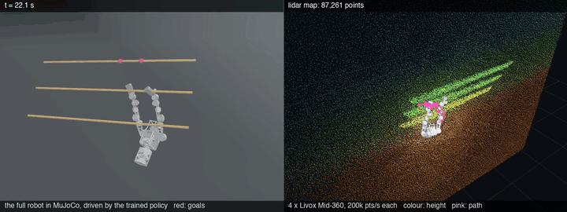

# Bimanual wall-climbing robot

A 24.2 kg two-armed robot that hangs from wall rungs by hooked hands, in MuJoCo, and
a PPO policy that learns to climb with it.

| | |
|---|---|
| [`cad/`](cad/README.md) | the mechanical design: vendor actuator and lidar CAD, the brackets between them, and the tools that check both — the robot is generated from here |
| [`urdf/`](urdf/README.md) | the generated robot, the scene, 86 sensors, the four lidars, and the measured properties of all of it |
| [`rl/`](rl/README.md) | the task, its reward and sensor models, the nine-lesson benchmark, generated walls with ADR, reference climbs, and PPO on MJX (GPU) |
| [`slam/`](slam/README.md) | the SLAM test rig: simulated Mid-360 point clouds through FAST-LIO2 in Docker |
| [`demo/`](demo/README.md) | demo videos: the policy climbing beside the map its lidars build |

```bash
python -m venv .venv && . .venv/bin/activate     # Windows: .venv\Scripts\activate
pip install -r requirements.txt

python -m rl.lessons                 # generate the lesson scenes (not in git)
python -m rl.climb_task              # the RL task, plus every reward and sensor invariant
bash rl/gpu_setup.sh && bash rl/gpu_run.sh run1    # train on a rented GPU box, unattended
python -m rl.eval --name run1 --from-best           # the benchmark on the full robot
python -m rl.demo --run out/run1 --lessons 1,2,3   # demo videos, with the lidar map
```

## Demo

Left: the full robot in MuJoCo. Right: the map its four Livox Mid-360 lidars build as it
climbs, simulated point by point along the sensor's own scan pattern. More, and how they
were made, in [`demo/`](demo/README.md).

| step up a tier (lesson 6) | round the corner (lesson 7) |
|---|---|
| [](demo/lesson06_step_up.mp4) | [](demo/lesson07_wall_corner.mp4) |

| climb up rows standing out (lesson 3) |
|---|
| [](demo/lesson03_climb_up_mirror.mp4) |

## The benchmark

Nine lessons, one skill each, scored on the full robot both ways round
([`rl/README.md`](rl/README.md)):

| | | | |
|---|---|---|---|
| 1 traverse along a rung | 2 traverse a broken rung | 3 climb up rows standing out | 4 climb down rows standing in |
| 5 down a staircase | 6 diagonally up a tier | 7 round a corner | 8 onto the wall behind |
| 9 swing across a gap | | | |

Training draws procedurally generated walls, one family per lesson, grown by automatic
domain randomization, with reference climbs (CEM) where PPO's noise alone never finds the
move. Status (v0.1.0): the pipeline is complete and checked end to end; the run that
scores it from scratch is next. The demo policy is an earlier run's: lessons 1, 5, 6, 7
4/4 on the full robot, 2 and 3 not yet reliable, 4 and 9 untrained.

## Real parts, not blocks

Every joint is a purchasable CubeMars AK-series actuator, every mass and inertia comes
from the CAD solids, and every torque limit off a datasheet. Nothing in `urdf/` is a
plausible-looking number, and nothing there is hand-written: `cad/tools/gen_urdf.py`
and `urdf/_gen_scene.py` write it.

The robot this replaced — aluminium cylinders with masses derived from geometry,
11.13 kg, fine in simulation and impossible to build — is in git history. The cost of
being real is **21.52 kg instead of 11.13**, more than half of it in the actuators,
and 24.16 kg with the four Livox Mid-360 lidars and the tube cage that guards them
(`urdf/README.md`, "The lidars"). The shoulder is pitch-first, like ten of the twelve
humanoids it was checked against. Its vertical reach is 0.56 m, above the 0.45 m the
rung rows are spaced.

## Where it stands

**The policy sees what the hardware would.** Encoders, IMU, F/T and pads have noise
and per-episode offsets. The wall map holds only what the four Mid-360 have seen past
the robot's own arms and cage, off rung by rung as a fitted map is. The lidar SLAM
drifts, arrives late, and is believed along a rung only where a wall faces that way:
measured with FAST-LIO2 on simulated Mid-360s, a flat wall does not tell a lidar
where it is along the wall (`slam/README.md`). Every policy trained before this is
void. Train from scratch.

**The RL side** trains on MJX, and its main output so far is a list of
things the task rewarded that were not climbing — the hook slides along a smooth
rung, a reward that pays one direction can be pumped, a sum over two hands does not
care which hand works. Each is now an assertion in `python -m rl.climb_task`.

A classical controller (anchor-rooted IK, A\* over the holds) came first and was
removed on 2026-09-30. Its state estimate lives on as `rl/estimator.py`, and the rest
is in git history.

## Platforms

Training runs on an NVIDIA GPU: the physics, the task and the policy on the card
(`rl/mjx_task.py`, checked against the C MuJoCo task to 1e-15 by `rl.mjx_check`);
`requirements-gpu.txt` pins that stack. Everything else -- the checks, the benchmark,
the figures -- runs on macOS, Linux and Windows, MJX itself too, slowly, on a CPU.

`ffmpeg` is needed only by `rl.render`, never for training. Docker is needed only by
the SLAM rig.

## Two rules that shaped everything here

**The policy reads only what real hardware has** — encoders, IMU, force/torque, grip
pads, and a wall map from its own lidars. Ground truth (`data.xpos`, `env.latched`)
appears in tests and in the RL reward, which is a training-time oracle, and nowhere
else.

**Measure, then decide.** Nearly every design choice in the subsystem READMEs is
followed by the number that forced it, and several of them overturned an idea that
looked obviously right first — including a pinned-base reach calculation that was
wrong by 2x, and a "fix" for hand crossing that quietly made the hands overlap
instead.

## License

Copyright (c) 2026 Thuong Nguyen Van. All rights reserved — public to read, run and
review, not to reuse or publish from without permission ([`LICENSE`](LICENSE)). To cite
it, see [`CITATION.cff`](CITATION.cff).
